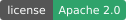
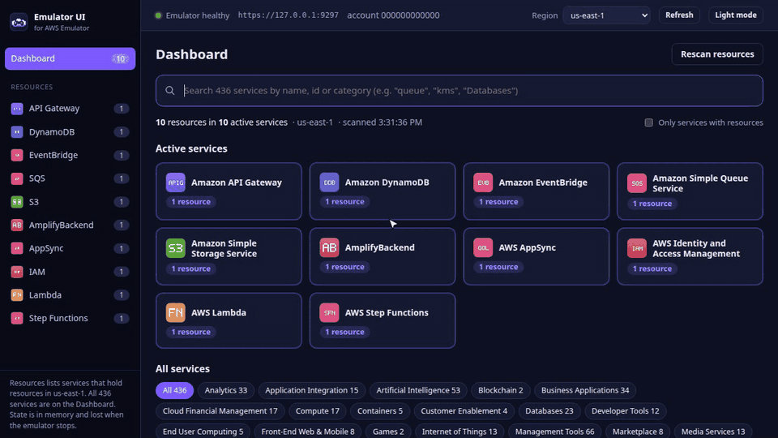

<p align="center">
  
</p>

<p align="center">
  
</p>

<h1 align="center">Emulator UI</h1>

<h3 align="center">A web console for AWS Emulator.</h3>

<p align="center">
  Browse and interact with the resources in a locally running
  <a href="https://github.com/aws/aws-emulator">AWS Emulator</a>, for all 436 services it supports.
</p>

<p align="center">
  
  
  
  
  
  
</p>

<p align="center">
  <a href="#quick-start">Quick start</a> ◆
  <a href="#emulator-requirements">Emulator requirements</a> ◆
  <a href="#features">Features</a> ◆
  <a href="#development">Development</a> ◆
  <a href="#contact">Contact</a>
</p>

<p align="center">
  
</p>

## Quick start

Requires Docker and a running AWS Emulator (see [Emulator requirements](#emulator-requirements)).

```bash
git clone https://github.com/D33ptar00p/emulator-ui.git && cd emulator-ui
make up-image   # pull the prebuilt image (amd64/arm64) + start -> http://127.0.0.1:8080
make up         # or build the image from source
make down       # stop the console
```

The console runs in its own container and never starts or stops emulators. Start them in any order; the console
picks up emulator restarts, new regions and new keys on its own.

## Emulator requirements

| | |
|---|---|
| Container | named `aws-emulator-<port>` (default port `9297`), on the Docker network `aws-emulator`, listening on `0.0.0.0:<port>` inside the container |
| Files | the emulator's `emulator_credentials`, `config` and `ca.pem` in `~/.aws/emulator/<port>/` on the host |
| Host port | published on `127.0.0.1:<port>` (used by `make dev` and `make test`) |
| Regions (optional) | `~/.aws/emulator/regions` with `region=port` lines for regions that have their own emulator |

Example, with an image built from the [official Dockerfile](https://docs.aws.amazon.com/emulator/latest/userguide/getting-started-docker.html)
and tagged `aws-emulator`:

```bash
docker network create aws-emulator 2>/dev/null || true
mkdir -p ~/.aws/emulator
docker run -d --rm --name aws-emulator-9297 --network aws-emulator \
  --user "$(id -u):$(id -g)" -p 127.0.0.1:9297:9297 \
  -e HOME="$HOME" -v "$HOME/.aws/emulator:$HOME/.aws/emulator" \
  aws-emulator -p 9297 --telemetry off
```

## Features

- **Dashboard:** search all 436 services. Services holding resources are listed first, the rest are grouped by
  category. The sidebar lists only active services, with counts.
- **Any service:** browse its resources as tables, or run *any* API operation from a JSON editor pre-filled from the
  API model.
- **Dedicated pages:**
  - DynamoDB items, S3 browser, Lambda invoke;
  - API Gateway requests;
  - Step Functions executions, EventBridge events, SQS messages;
  - AppSync and IAM.
- **Region switcher:** shared regions use the default emulator; isolated regions (listed in
  `~/.aws/emulator/regions`) get their own.
- **Safe by default:**
  - localhost only;
  - CSRF and DNS-rebinding guards;
  - never calls a non-local endpoint;
  - destructive actions ask for confirmation.

  See [SECURITY.md](SECURITY.md).

Resource counts exclude the items a fresh emulator already has (recorded in `src/emulator_ui/inventory_baseline.json`).

## Troubleshooting

| Symptom | Fix |
|---|---|
| "Emulator unreachable" / "Emulator is off." | Start an emulator that meets the [requirements](#emulator-requirements). |
| No resources | Emulators keep state in memory, so a new run is empty. Create resources, then click **Rescan resources**. |
| Resource missing in another region | Check the region switcher; regions can be isolated. |
| "Not implemented by the emulator yet (501)" | The emulator doesn't support that operation yet. |

## Development

```bash
make dev           # API on :8081 with reload + Vite on http://127.0.0.1:5173
make test          # backend tests (live tests need a running emulator)
make ui-test       # frontend typecheck + tests
make lint          # ruff + shellcheck
make catalog       # regenerate the service catalog and icons (offline)
make inventory-baseline   # re-record a fresh emulator's built-in items
```

Backend: FastAPI in `src/emulator_ui/`. Frontend: React + TypeScript (Vite) in `ui/`. Inside the container, the
console reaches each emulator over the `aws-emulator` network through a loopback relay, so TLS is verified end to end
against the emulator's own certificate. API docs: http://127.0.0.1:8080/api/docs.

## Contact

- Bugs and questions: [GitHub Issues](https://github.com/D33ptar00p/emulator-ui/issues)
- Contributing: see [CONTRIBUTING.md](CONTRIBUTING.md)
- Security: see [SECURITY.md](SECURITY.md); don't open public issues
- Other: Deeptaroop Mojumdar, deeptaroop2015@gmail.com

## License

[Apache License 2.0](LICENSE). Copyright 2026 Deeptaroop Mojumdar. See [NOTICE](NOTICE).
